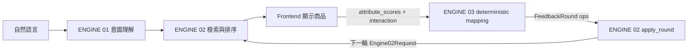

# ENGINE 03 — 結構化互動回饋

ENGINE 03 不處理自然語言，也不呼叫 LLM。它把前端的評分與明確互動，轉成 ENGINE 02 可套用的 operations。

## 責任邊界



1. 自然語言：`Frontend → ENGINE 01 → ENGINE 02`。
2. 結構化回饋：`Frontend → ENGINE 03 → ENGINE 02`。
3. ENGINE 03 不更新 Intent、不產生圖片 prompt，也不從分數猜使用者按了哪個按鈕。

## 前端互動規則

商品狀態必須來自明確操作：

| 使用者動作 | 輸入欄位 | ENGINE 02 operation | 意義 |
|---|---|---|---|
| 愛心／選擇 | `chosen_item_id` | `choice.chosen_item_id` | 本輪最偏好的商品；每輪至多一個 |
| 不喜歡 | `rejected_item_ids` | `choice.rejected_item_ids` | 負向偏好訊號，可有多個，但不是永久封鎖 |
| 不要再出現 | `excluded_item_ids` | `exclude_item` | 永久排除商品，可有多個 |
| 以此搭配 | `anchor_item_ids` | `anchor` | 搭配參考，可來自本輪、衣櫃或先前輪次 |
| 設計維度評分 | `attribute_scores` | `adjust` | 改變排序的軟性權重，不代表選擇／拒絕 |

`anchor` 不由排名或評分自動決定。使用者在 UI 明確按「以此搭配」才會建立；`replace_anchors=true` 取代既有 anchor，`false` 則加入既有 anchor。

## POST `/feedback`

### Request

```json
{
  "session_id": "demo-interview",
  "round": 1,
  "attribute_scores": [
    {"element": "formal_style", "score": 0.2},
    {"element": "soft_knit", "score": 0.8}
  ],
  "interaction": {
    "chosen_item_id": "B",
    "rejected_item_ids": ["A"],
    "excluded_item_ids": ["C"],
    "anchor_item_ids": ["wardrobe-pants-7"],
    "replace_anchors": true
  },
  "engine02_request": {
    "session_id": "demo-interview",
    "round": 1
  },
  "engine02_response": {
    "session_id": "demo-interview",
    "round": 1,
    "items": [
      {"item_id": "A", "rank": 1, "title": "A", "score": 4.1},
      {"item_id": "B", "rank": 2, "title": "B", "score": 3.9},
      {"item_id": "C", "rank": 3, "title": "C", "score": 3.4}
    ]
  },
  "allowed_design_elements": ["formal_style", "soft_knit"]
}
```

### 每個變數

| 變數 | 說明 |
|---|---|
| `session_id` | 同一段推薦工作階段的 ID；必須和兩份 ENGINE 02 context 相同 |
| `round` | 使用者正在回饋的推薦輪次；必須和兩份 ENGINE 02 context 相同 |
| `attribute_scores` | 使用者對 ENGINE 02 設計維度的 0–1 評分；同一維度每次最多一筆 |
| `attribute_scores[].element` | ENGINE 02 `/kansei` 提供的設計維度 ID，不是商品 ID |
| `attribute_scores[].score` | `< 0.4` 產生 `step=-1`；`0.4–0.6` 不調整；`> 0.6` 產生 `step=+1` |
| `interaction.chosen_item_id` | 本輪唯一選中的商品；必須在本輪顯示清單內 |
| `interaction.rejected_item_ids` | 本輪明確不喜歡的商品；必須在本輪清單內，可多個 |
| `interaction.excluded_item_ids` | 永久不再推薦的商品；必須在本輪清單內，可多個 |
| `interaction.anchor_item_ids` | 搭配基準；允許使用衣櫃或舊輪次 ID，因此不限制在本輪清單 |
| `interaction.replace_anchors` | `true` 取代舊 anchor；`false` 追加 |
| `engine02_request` | 本輪輸入 ENGINE 02 的 context；ENGINE 03 用它驗證 session／round |
| `engine02_response` | 本輪 ENGINE 02 顯示結果；順序用來建立 `shown_item_ids`，並驗證 choice／exclude |
| `allowed_design_elements` | ENGINE 02 允許調整的維度白名單；未知維度進 `rejected_ops` |

`interaction` 與 `attribute_scores` 可擇一送，也可以同輪一起送。自然語言另送 ENGINE 01，不放在這個 request。

### Response

```json
{
  "contract_version": "0.2.0",
  "engine02_feedback": {
    "session_id": "demo-interview",
    "round": 1,
    "utterance": null,
    "ops": [
      {"op": "adjust", "element": "formal_style", "step": -1, "quote": null},
      {"op": "adjust", "element": "soft_knit", "step": 1, "quote": null},
      {
        "op": "choice",
        "shown_item_ids": ["A", "B", "C"],
        "chosen_item_id": "B",
        "rejected_item_ids": ["A"]
      },
      {"op": "exclude_item", "item_ids": ["C"]},
      {"op": "anchor", "item_ids": ["wardrobe-pants-7"], "replace": true}
    ]
  },
  "rejected_ops": []
}
```

`rejected_ops` 會保留無法安全套用的操作和原因，例如未知設計維度，或 choice／exclude 引用了本輪沒有顯示的商品。

## ENGINE 02 如何受影響

ENGINE 03 只產生增量操作，不自行推薦商品。ENGINE 02 的 `apply_round()` 將 operations 累積進下一輪 request：

- `adjust` 累積到設計維度調整，改變設計分數在排序中的權重。
- `choice` 寫入 choice history，讓 ENGINE 02 使用選中與拒絕商品的特徵作偏好訊號。
- `exclude_item` 寫入永久排除 ID，候選生成時移除。
- `anchor` 啟用商品相容性／搭配訊號。

ENGINE 02 仍保留商品資料、embedding、design scores、constraints、needs 與歷史 feedback，並由它完成候選檢索和排序。

## 驗證規則

- `session_id`、`round` 必須與 ENGINE 02 request/response 一致。
- 至少要有一筆 `attribute_scores` 或一個明確互動。
- 同一商品不可同時 chosen 和 rejected／excluded，也不可同時 rejected 和 excluded。
- choice／rejected／excluded 必須指向本輪顯示的商品。
- anchor 可指向衣櫃或舊輪次商品。
- 未知 design element 不會靜默忽略，而會回到 `rejected_ops`。

## 執行與測試

```powershell
uvicorn backend.engine03_feedback.main:app --reload --port 8003
pytest -q backend/engine03_feedback/tests
```

API：

- `POST /feedback`
- `GET /contract/engine02-feedback`
- `GET /health`

舊路徑 `POST /api/engine3/process_feedback` 暫時保留為隱藏 alias。
