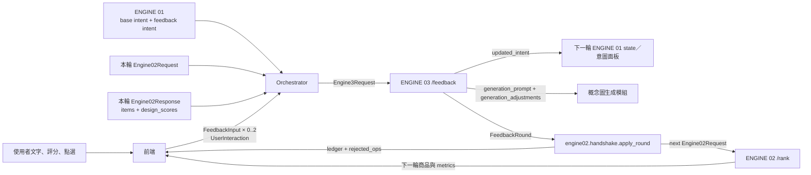

# ENGINE 03 — 偏好回饋迴圈

這個資料夾可直接放進 `engine01-intent` 整合框架的 `backend/engine03_feedback/`。入口重用 `backend.shared.schemas.Intent` 與 `FeedbackInput`；出口 `engine02_feedback` 對齊 `engine02-research` 的 `FeedbackRound` contract `0.1.0`。

## 整體資料流



一輪的責任邊界：

1. 前端送 0–2 筆共用 `FeedbackInput`：`recommended`、`generated` 各最多一筆；每筆文字必填，評分選填，點選商品另放 `interaction`。
2. 推薦回饋文字先交給 ENGINE 01，產生 `feedback_intent`；ENGINE 03 比較它與 `current_intent`，再融合評分與點選。
3. ENGINE 02 的 `apply_round()` 負責累加 operation、裁切步數、維護 choice history，產生下一輪 request 與可解釋 ledger。
4. `recommended` 只產生 ENGINE 02 ops；`generated` 只產生 `generation_prompt` 與 `generation_adjustments`，兩條路徑在程式層分開。

## 檔案

| 檔案 | 用途 |
|---|---|
| `contracts.py` | ENGINE 01 共用輸入、ENGINE 02 context、8 種 operation 與 API I/O |
| `prompts.py` | structured-output system prompt |
| `service.py` | LLM 轉譯、UI operation、詞彙與 ID 驗證 |
| `main.py` | FastAPI `/feedback`、`/health`、schema endpoint |
| `examples/click_only_request.json` | 不需 API key 的最小 request |
| `tests/test_service.py` | session/round、0–1 評分與 click-only handoff 測試 |

## 啟動

從整合框架 repo 根目錄執行：

```bash
pip install -r backend/requirements.txt
uvicorn backend.engine03_feedback.main:app --reload --port 8003
```

開發時可在 `.env` 設：

```dotenv
DEV_BYPASS_AUTH=true
OPENAI_API_KEY=...
ENGINE3_MODEL=gpt-4o-mini
```

`/feedback` 沿用整合框架的 `get_current_user`，正式 demo 必須關閉 `DEV_BYPASS_AUTH`。只有 click-only request 會完全走 deterministic path、不需要 `OPENAI_API_KEY`；只要有文字、選項或分項評分就需要 key。

## API

| Method | Path | 說明 |
|---|---|---|
| `POST` | `/feedback` | `Engine3Request` → `Engine3Response` |
| `GET` | `/contract/engine02-feedback` | ENGINE 02 handoff 的 JSON Schema |
| `GET` | `/health` | service 與 contract version |

舊路徑 `/api/engine3/process_feedback` 暫時保留為隱藏 alias，方便現有前端過渡。

### 輸入重點

```json
{
  "current_intent": {"item_type": "top", "colors": [], "inferred_fields": []},
  "feedback_intent": {
    "item_type": "top",
    "colors": [],
    "style_keywords": ["休閒"],
    "inferred_fields": []
  },
  "feedback_inputs": [
    {
      "session_id": "demo-interview",
      "round": 1,
      "target": "recommended",
      "attribute_scores": [{"attribute": "fit", "score": 0.3, "comment": "太正式"}],
      "free_text": "不要黑色，希望休閒一點",
      "selected_option_id": null
    }
  ],
  "engine02_request": {"session_id": "demo-interview", "round": 1},
  "engine02_response": {
    "session_id": "demo-interview",
    "round": 1,
    "items": [{"item_id": "14731", "rank": 1, "title": "Shirt", "score": 3.1}]
  },
  "interaction": {"chosen_item_id": "14731"},
  "allowed_design_elements": ["formal_style", "casual_style"],
  "allowed_attribute_values": {"color": ["Black", "Navy Blue"]}
}
```

硬性驗證：

- `FeedbackInput.session_id/round` 必須和 ENGINE 02 request/response 一致。
- 每筆 `FeedbackInput.free_text` 必填且不可是空白；純商品點選不建立 `FeedbackInput`，改放 `interaction`。
- `target="recommended"` 的文字必須先經 ENGINE 01，並把完整候選 Intent 放入 `feedback_intent`。
- `FeedbackInput.attribute_scores[].score` 使用整合框架文件定義的 0–1。
- choice／exclude item 必須是本輪 `items` 出現過的 ID。
- `adjust.element` 應來自 ENGINE 02 `GET /kansei`；商品屬性值應來自 `GET /vocabulary`。

### 輸出重點

```json
{
  "contract_version": "0.1.0",
  "reasoning": "使用者排除黑色並希望降低正式感。",
  "engine02_feedback": {
    "session_id": "demo-interview",
    "round": 1,
    "utterance": "不要黑色，希望休閒一點",
    "ops": [
      {"op": "exclude", "attribute": "color", "value": "Black", "quote": "不要黑色"},
      {"op": "adjust", "element": "formal_style", "step": -1, "quote": "希望休閒一點"},
      {
        "op": "choice",
        "shown_item_ids": ["14731"],
        "chosen_item_id": "14731",
        "rejected_item_ids": []
      }
    ]
  },
  "updated_intent": {"item_type": "top", "colors": [], "inferred_fields": []},
  "generation_prompt": "一件適合面試但偏休閒、非黑色的上衣",
  "generation_adjustments": [],
  "rejected_ops": []
}
```

`target="generated"` 不會產生任何 ENGINE 02 operation；其輸出範例如下：

```json
{
  "engine02_feedback": {"session_id": "abc123", "round": 1, "utterance": null, "ops": []},
  "generation_prompt": "柔和、休閒輪廓的面試上衣",
  "generation_adjustments": [
    {"attribute": "fit", "direction": -1, "strength": 0.6, "reason": "輪廓太正式"}
  ]
}
```

## ENGINE 02 handoff

合併 `engine02-research` 後，orchestrator 執行：

```python
from engine02.handshake import FeedbackRound, apply_round

feedback = FeedbackRound.model_validate(engine3_response.engine02_feedback.model_dump())
handoff = apply_round(previous_engine02_request, previous_engine02_response, feedback, kansei=kansei)
next_engine02_request = handoff.request
ledger = handoff.ledger
rejected_by_engine02 = handoff.rejected_ops
```

`ledger` 是前端解釋「這次回饋改了什麼」的真相來源，不要自行從卡片分數推回去。

## Operation 對照

| operation | 來源例子 | 下一輪效果 |
|---|---|---|
| `exclude` | 不要黑色 | 永久寫入 `excluded_values` |
| `require` | 一定要海軍藍 | 永久寫入 `required_values` |
| `adjust` | 再休閒一點 | ±1 步；ENGINE 02 累加並裁切至 ±3 |
| `choice` | 點選／否決卡片 | 累積 `choice_history`，由 ENGINE 02 學偏好 |
| `feeling` | 不想顯得太用力 | 更新既有 need probabilities |
| `critique` | 這件但換成藍色 | 單輪 reference＋永久目標值 |
| `anchor` | 搭我這件褲子 | 啟用相容性訊號 |
| `exclude_item` | 不要再出現這件 | 永久排除商品 ID |

## 測試

```bash
pytest -q backend/engine03_feedback/tests
```

手動測 click-only request：

```powershell
Invoke-RestMethod -Method Post `
  -Uri http://127.0.0.1:8003/feedback `
  -Headers @{ Authorization = 'Bearer dev' } `
  -ContentType 'application/json' `
  -InFile .\backend\engine03_feedback\examples\click_only_request.json
```

`DEV_BYPASS_AUTH=true` 時 `Bearer dev` 的內容不會被驗證；正式模式必須使用 `/auth/google` 回傳的真實 session token。
