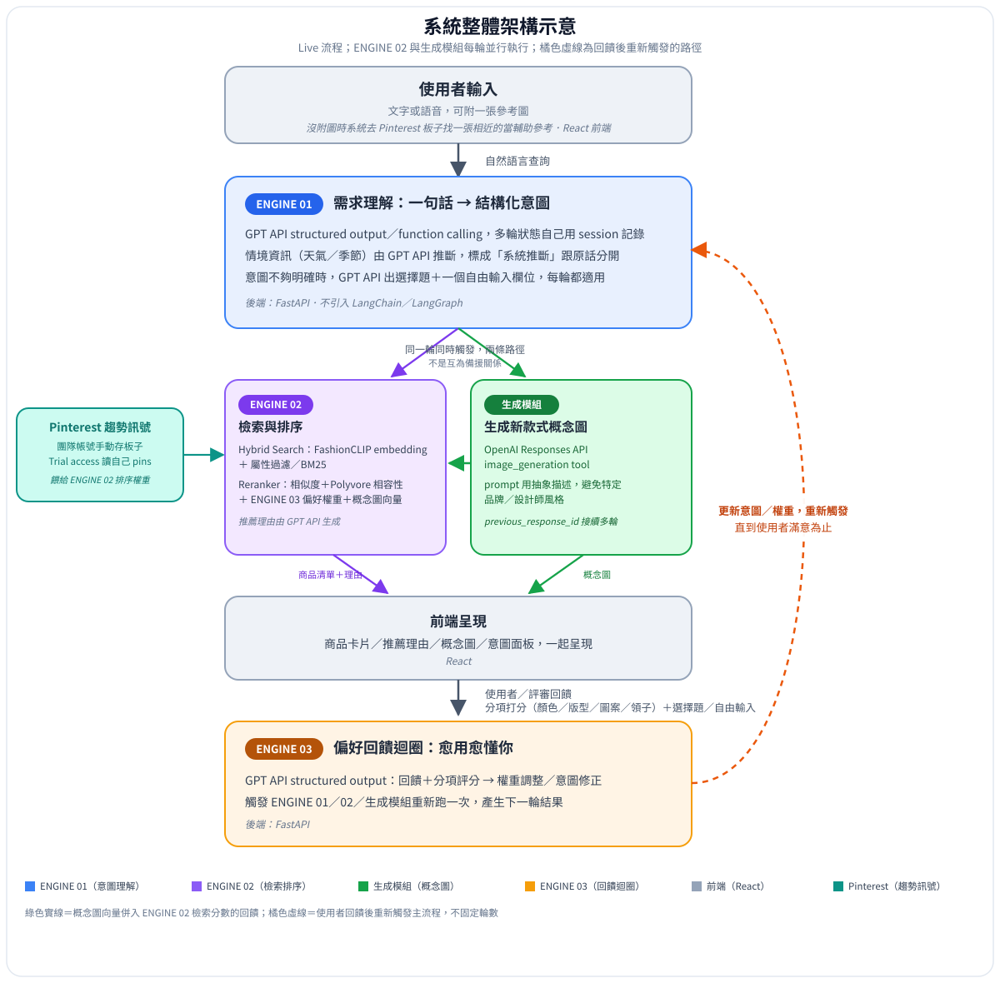
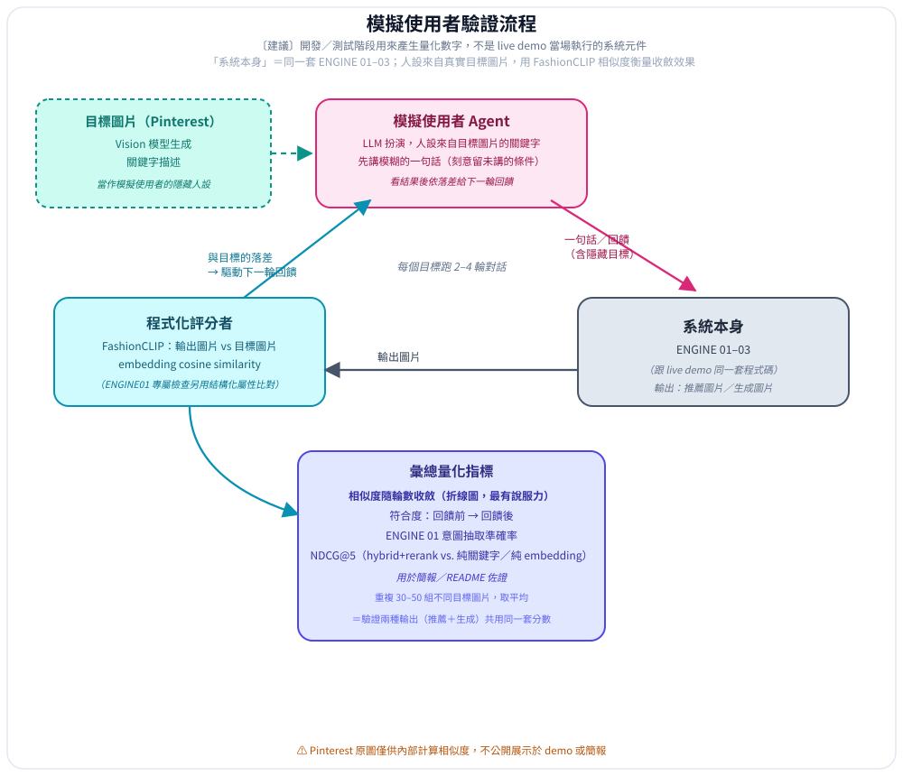

# 黑客松命題說明會重點整理

對應檔案：黑客松逐字稿_校正版.md，括號內時間可直接對照逐字稿段落。逐字稿辨識品質不佳，以下只整理可以合理還原的內容，推測的部分會註明。本版另外納入六張說明會投影片照片（1000089918–1000089923.jpg）的內容，投影片文字比逐字稿清楚，優先以投影片為準；投影片截圖也有拍攝角度與解析度造成的辨識不確定處，一樣用〔?〕標註。

本文件寫給沒有參加說明會、但要一起參與比賽設計的組員，目標是讓你不用聽錄音也能掌握題目全貌。

## 基本資訊

- 黑客松名稱：投影片標題為「2026 梅竹黑客松 x 聚陽實業」，檔名為「題目說明_工作坊簡報_給方向版_2026-09-04」，可知這是梅竹黑客松系列活動之一，聚陽實業是出題企業。
- 命題企業：聚陽實業。講者自述不做自有品牌，替品牌客戶設計與生產衣服，並提到「台灣規模最大」。（05:02、19:02、23:49）投影片左上角標示「聚陽實業‧資訊處」，推測講者是資訊處代表，這也可以說明投影片上技術對照給得相當具體。
- 題目：「一句話讀懂消費者」。（02:13）
- 說明會日期：投影片畫面右下角時間戳顯示為 2026 年 9 月 4 日下午。
- 比賽日：9 月 19 日；說明會當時距比賽約 15 天。（26:22、28:29）與投影片日期換算吻合。
- 評審：講者表示自己也是評審委員之一。（10:00、31:38）

## 交付項目（依投影片第 9 頁，確認版）

逐字稿只聽到「準備一支影片、一份現場報告投影片」（17:52），投影片第 9 頁「你們最後要繳交什麼」給出完整四項，以此為準：

1. 可實際運作的 prototype / demo，並可現場互動展示。
2. GitHub 原始碼＋英文 README，讓其他人可以重現。
3. 2–3 分鐘 Demo 影片（MP4）。
4. 現場問答與調整，不要求繳交後續的模型權重。

## 企業背景與痛點

成衣位於紡織產業鏈最末端：上游紡紗織布，布送到成衣廠裁剪縫製，再交給品牌商銷售。講者也坦言，「穿搭」本身不一定是成衣廠最核心的關注點，但消費者在想什麼是他們想了解的。（03:38–03:54）

聚陽的定位是製造商，但希望和品牌客戶站在同一條線上。他們替客戶設計款式，也會把趨勢提供給客戶，所以同樣需要知道消費者在想什麼。內部已經有抓趨勢、收集資料的平台。（05:02–06:30）

現有能力是收集電商平台上的購後回饋（講者提到的詞原辨識為「bot」，推測是 VOC, Voice of Customer），分析正負評與可改進之處，提供給品牌客戶，也從中觀察下一波趨勢的轉變。（06:30–06:58）

缺口在於購後回饋屬於「後端」訊號，消費者購買前想要什麼的「前端」意圖目前收集不到。講者明說這可能就是題目的一部分。（07:46–08:02）

企業的期望：設計流程是「趨勢 → 設計師發想 → 選款 → 材料與生產 → 品牌商店」，希望前端意圖能回流到設計師這一段，讓商品企劃越來越精準。（08:17–08:37）

## 題目核心要求

講者的出發點是：過去購物靠關鍵字和分類搜尋，現在大家習慣用自然語言和具備代理能力的 AI 互動。題目的關鍵是「需求理解」，並把需求分析成結構化、可以分析的資料。（10:46）

講者明確提醒不要只把它想成聊天機器人，系統最重要要做到三點（13:26）：

1. 理解：理解使用者在說什麼、需求是什麼。
2. 解釋：對產出的結果做有效解釋，對象包含使用者和評審委員。講者特別對比過去 AI 像黑盒子、主管問「怎麼跑出來的」答不出來的經驗。（10:46–12:59）
3. 自我提升：透過使用者回饋自動調整，下一次的結果比第一次更準。

題目最主要的目的是：系統累積越來越多消費者需求資訊後，這些資訊要能被整個紡織產業鏈使用。如何建構系統並蒐集這些資料是很重要的一環。（13:26–15:16）

這三點在投影片上直接對應到「三大技術引擎」（ENGINE 01–03），下面單獨整理。

## 三大技術引擎（投影片第 5–7 頁，技術對照僅供參考）

投影片每頁都註明「技術對照（僅供參考，不限於此，鼓勵你們找更好的做法）」，代表下列技術只是舉例，不是要求。

### ENGINE 01｜需求理解：把「一句話」變成「結構化意圖」

- 技術對照：slot filling／資訊抽取（NER）、LLM 結構化輸出（JSON／tool use）、對話狀態管理。
- 重點：真本事在「抽得準＋接得住模糊」，而不是把字面照抄。

### ENGINE 02｜可解釋性的 AI

- 技術對照：內容式推薦＋排序、影像／文字 embedding（如 FashionCLIP）、穿搭相容性（如 Polyvore）、〔?〕規則化的文字解釋。
- 難點：在約束下維持推薦品質，而不是隨便解釋〔?〕。（此頁部分文字拍攝角度較斜，辨識信心較低）

### ENGINE 03｜偏好回饋迴圈：愈用愈懂你

- 技術對照：偏好建模、線上個人化、bandits／輕量學習；偏好訊號可回饋到開款、備料、生產。
- 回饋題目：回饋是否「量化可驗證」是評分重點之一。

### 給你們的提醒（投影片第 8 頁原文）

標題「重點不在『串一個聊天機器人』」，內容整理如下：

- 可理解：真的聽懂使用者要什麼，包含沒說出口的隱含需求。
- 可解釋：說得出「為什麼」，而不是黑箱丟出一個結果。
- 可變強：愈用愈懂你，而且進步是看得見、可被驗證的。

投影片原句：「把這三件事做扎實，這才是真本事。」

## 現場評測方式

現場流程大致是：評審出題讓參賽系統執行，看完結果後給回饋或指示，再提供第二次題目，檢查系統是否依第一次的回饋修正、結果是否更接近評審要的。講者認為這項自我提升能力是拉開分數的關鍵之一，也對應到上面的 ENGINE 03。（13:26、17:16–17:52）

## 評分標準（投影片第 10 頁，確認版）

逐字稿只聽清楚第一項約 35%（20:12–22:03），其餘三項配分投影片有完整列出，四項加總剛好 100%，可以互相印證：

| 評分標準 | 配分 | 說明 |
|---|---|---|
| 問題理解與契合度 | 35% | 是否真的抓對題目、展現對消費者體驗的洞察與獨到切入。 |
| 技術方案與資料應用〔?〕 | 35% | 自然語言理解、意圖建模、資料處理的技術含量與方法合理性。 |
| 呈現完整度與可行性〔?〕 | 20% | Demo 完整度：能否流暢完整展現、回饋迴圈是否可驗證。 |
| 表達與應變〔?〕 | 10% | 臨場應變、問題與解法的邏輯完整性。 |

三、四項的標準名稱因拍攝角度較模糊，字面有〔?〕標註處建議之後對照原始簡報檔（html 檔：題目說明_工作坊簡報_給方向版_2026-09-04.html）複核，但配分數字（35/35/20/10）看得清楚。

講者口頭強調更在意前兩項，重點是對行為的理解和延伸出來的創意，而不是展示得多完整（21:32），這和「問題理解＋技術方案」合計 70% 的配分吻合。

## 技術與資料

- 技術完全不設限，簡報上的技術只是參考。題目算開放，預期各組做出來的樣子和用的技術都會很不一樣。（10:46）
- 有學生問系統能否連網使用、還是必須離線運作，回答是視採用的技術而定，講者沒有明確禁止或允許連網／線上 API。（18:10–18:19）
- 企業不提供內部資料。聽得出的原因是他們不做品牌、資料涉及平台上的客戶，量也太大，不能大量公開（此段辨識不完整）。（19:02–19:18）
- 替代方案是簡報上列出可公開使用的資料來源，包含大量服裝資料庫、消費者回饋，以及流行趨勢資料的來源平台。講者自己用這些資料做過測試，確認可以執行。（19:18–19:43）目前六張投影片照片沒有拍到列出資料來源名稱的那一頁（推測在第 5 頁之前，即第 2–4 頁之間），具體平台名稱仍待確認。
- 資料和技術都只是建議，可以自行取得其他資料。使用企業提供的資料或技術不會比較高分，搭配不同資料反而是他們期待看到的。（19:43–20:12）

## 產品形態

題目涉及三個角色：工廠、品牌商、消費者。品牌商關心外部流行，以及消費者在什麼狀態下會買什麼；工廠要關注什麼，講者留給參賽者自己想。但企業真正關心的是位於最末端的消費者。（26:22）

有學生問成品應該是給企業內部參考的量化分析工具，還是給消費者使用的介面。回答聽起來是畫面不設限，但依整場說明的脈絡，方向是從消費者端產生需求，再直接進入品牌商和製造供應鏈。（31:09–31:25）

## 創意與可行性

- 技術如果沒辦法當場全部做完，可以用其他方式說明。（31:52）
- 最重視看到企業沒想過的技術、理論或應用方式；不需要做大規模統計或龐大的系統。（32:02–32:12）
- 構想可以天馬行空，但不能是用手上資源絕對做不出來的。若在有資源的前提下、具未來發展性而可行，也可以納入。（32:46–32:50）

## 其他值得參考的內容

- 學生構想：使用者講一句話，用 LLM 抽出潛在意思和關鍵詞，再拿去搜尋，消費者不用自己想 keyword。講者認為蠻有參考價值，請大家記下來。（10:13–10:46）
- 講者自己的例子：他把外型、場合正式程度、想表達的感覺告訴 GPT，請它搭配穿著，結果跑出與新聞人物趙建銘相關、不符需求的穿搭。講者用這個例子說明「這其實就是我們的問題」。他似乎認為這和自己先前查過相關新聞有關，但這段辨識不完整。（24:00–25:34）
- 有學生提到 harness engineering，說是今年初在矽谷流行、和 AI agent 相關的技術，講者稱讚這非常先驅。（29:40–29:56）
- 往例：企業今年和台科大合作，由企業出題、學生解題。其中節電題目提供各工廠用電資料，學生用了企業過去沒想過的演算法，prototype 已由企業接手，準備做正式開發。企業對這次黑客松抱同樣期待，認為題目做出來會是對整個成衣產業鏈都有幫助的產品。（33:19–35:00）
- 講者強調成衣業雖然是傳統產業，但正大量投入數位轉型與 AI，可探索的空間很大。（35:34–36:50）

## 待確認事項

- 資料來源：投影片應該有列出具體資料集與平台名稱（逐字稿 19:18–19:43 提到），但目前六張照片沒有拍到那一頁，推測在編號第 5 頁之前。需要跟拍到其他頁的組員確認，或另外索取完整簡報檔。團隊這邊已經自己決定商品庫要用 Polyvore Outfits Dataset（見「目前完整架構」ENGINE 02 小節），這則待確認事項剩下的意義是核對企業原本指定的資料來源，不影響開發進度。
- 簡報缺頁：目前只有第 5–10 頁的截圖，簡報共 11 頁，缺少第 1–4 頁（推測是標題、企業介紹、痛點鋪陳）與第 11 頁（推測是結尾或補充），建議取得完整簡報檔案。
- 現場網路與 API：講者僅答「視採用的技術而定」，沒有明確允許或禁止連網或線上 API，實作時建議預留離線 fallback。
- ENGINE 02 與評分標準三、四項的技術對照文字：因拍攝角度與解析度問題辨識信心較低，已用〔?〕標註，建議取得原始簡報檔複核。
- 現場 demo 設備：逐字稿和投影片都沒有講清楚現場是用參賽隊伍自己帶的筆電，還是主辦方提供的設備／環境，也沒提到電源、螢幕等現場配置。只確定「現場會執行你們自己的系統，評審出題→看結果→給回饋→再出題」（17:16–17:52）。建議直接向主辦單位確認，demo 架構最好讓關鍵路徑不完全依賴外部網路，降低現場風險。

---

## 討論準備：比賽實作方向（供組內討論用，非最終決定）

接下來這幾節記錄怎麼推導出下面「目前完整架構與詳細實施方案」的過程與細節，包含理由、程式碼範例、討論過程中被捨棄的方案；兩邊如果有出入，一律以「目前完整架構與詳細實施方案」那節為準。

### 系統整體架構示意

以下是 live 流程對應的整體架構圖，圖檔另存為同資料夾內的 system-architecture.svg，用瀏覽器或支援 SVG 的檢視器開啟即可：



圖上 ENGINE 01 收到一句話後同時觸發 ENGINE 02 檢索和生成模組出概念圖，兩者並行、互相餵資料，一起回傳前端；使用者給回饋後進 ENGINE 03，更新權重觸發下一輪，直到使用者滿意為止。完整文字說明見後面「目前完整架構與詳細實施方案」的 Live 流程段落。

第一輪跟後續輪次的結果最好能在畫面上並排或有明顯對比，直接對應現場評測「出題→回饋→再出題→看有沒有更準」的流程，也是評分標準裡「回饋迴圈是否可驗證」那一項的具體呈現方式。

### 技術架構方向：RAG＋Hybrid Search＋Reranker

以下整段是根據上面 ENGINE 01–03 推出來的一個可能架構，投影片和逐字稿都沒有直接提到 RAG、hybrid search、reranker 這些名詞，是討論時評估出來、後來定案採用的方向，不是企業指定的做法。

- 檢索定位：ENGINE 01 產生結構化意圖之後，進入 ENGINE 02 本質上是從服裝資料裡找出符合條件的商品，適合用 RAG 的檢索半邊處理，而不是讓 LLM 憑空生成商品。
- Hybrid search 分工：dense 側用 FashionCLIP 這類影像／文字 embedding 抓語意風格相似度（如「簡約」「正式」「防水」），sparse 側用關鍵字／屬性過濾抓精確條件（顏色、價格區間、季節、尺寸），兩邊分數合併排序。
- Reranker 分工：把 FashionCLIP 的風格分數、Polyvore 穿搭相容性分數、ENGINE 03 學到的個人化權重三個訊號合併重新排序，決定最終呈現順序，也讓每個推薦結果可以回溯理由，天生帶有可解釋性，對應到題目反覆強調的「可解釋」要求。
- 回饋迴圈怎麼接：評審給回饋後，把回饋轉成結構化意圖的修正（例如調整某個屬性權重），再用同一套 hybrid search＋reranker 重新跑一次，結果因權重調整而不同，直接對應到現場評測「出題→回饋→再出題→看有沒有更準」的流程，是具體可以 demo 出來的橋段。

Hybrid search 跟 reranker 都自己實作，不引入 LlamaIndex、LangChain 這類框架，也不接 Cohere rerank 這類雲端 reranker API，理由和作法見下面「直接串 GPT API」小節。

### 前端／後端技術與開發工具

- 前端：React（搭配 Vite 開發環境）是合理選擇，需求只是輸入框、結果卡片、意圖面板、回饋按鈕，不需要 Next.js 這類含 SSR 的重框架；可以搭配 Tailwind CSS 或現成元件庫加快做卡片和排版的速度。
- 語音輸入：如果要做語音輸入，前端要加錄音元件，後端多一段語音轉文字（例如 OpenAI 的 Whisper API），這是原本沒有的技術依賴，實際只有比賽現場那兩天可以寫，時間夠不夠先評估；來不及的話現場 demo 退回純文字輸入，不影響其他核心流程。
- 後端：建議用 FastAPI（Python），因為 ENGINE 01–03 的 embedding、hybrid search、reranker 幾乎都是 Python 生態（sentence-transformers、FashionCLIP），前後端用 REST 或 WebSocket 溝通即可，不需要另外用 Node.js 重寫一套推薦邏輯。向量庫、sparse 檢索套件的選擇見後面 ENGINE 02 小節。
- 開發工具（Orca／Claude Code／Codex）：ENGINE 01、ENGINE 02、ENGINE 03、前端這幾塊當成平行開發線，各自在自己的 git worktree／branch 裡用 Claude Code 或 Codex 開發，Orca 負責統一監控進度、避免改到同一份 code；這套流程建議先試跑過，比賽現場只有那兩天可以寫程式，沒有餘裕邊寫邊除錯協作工具本身的問題，保留每個人都能直接在自己終端機用 Claude Code／Codex 繼續做的 fallback，不要讓整個開發進度綁死在 Orca 這一個工具上。

### 直接串 GPT API

可以直接呼叫 OpenAI 的 GPT API，這其實是 ENGINE 01 那段不用 LangChain、直接用 LLM structured output的具體做法，也可以延伸用在 ENGINE 02、ENGINE 03：

- ENGINE 01：把使用者一句話丟給 GPT API，用 structured output（指定 JSON schema）或 function calling，直接拿到結構化意圖，不需要額外框架。
- ENGINE 02：把 reranker 排序完的候選商品屬性（顏色、價格、風格標籤等）丟給 GPT，請它組織成一句自然的推薦理由文字；理由是根據真實檢索到的商品屬性寫的，不是憑空生成，可解釋性站得住腳。
- ENGINE 03：把評審的口頭回饋（例如「這件太正式了」）丟給 GPT 做 structured output，轉成具體的權重調整或屬性修正。

實作方式：到 platform.openai.com 申請 API key，後端（FastAPI）用官方 `openai` 套件呼叫，例如：

```python
from openai import OpenAI
client = OpenAI()  # 從環境變數 OPENAI_API_KEY 讀取金鑰

response = client.chat.completions.create(
    model="gpt-4o-mini",
    messages=[
        {"role": "system", "content": "把使用者的一句話轉成結構化 JSON 意圖。"},
        {"role": "user", "content": user_sentence},
    ],
    response_format={"type": "json_schema", "json_schema": {...}},
)
```

API key 用 `.env` 檔存放，`.gitignore` 排除，不要把金鑰直接寫進上傳到 GitHub 的程式碼裡。

費用：GPT API 原本是按 token 計費的付費服務，不過團隊已經有可免費使用的 GPT 帳號，不用再另外綁定付款方式或申請額度，這塊已經解決。列一下量方便抓感覺：GPT-4o-mini 每百萬 input token 約 0.15 美元、output token 約 0.6 美元，以這個專案的規模估算，一輪「意圖抽取＋推薦理由生成＋回饋轉換」大概用到 1,000–1,500 個 input token、300–500 個 output token，一輪成本不到 0.001 美元，比賽現場那兩天開發加測試也是很小的量。免費帳號實際的額度或速率限制目前不確定，開發時留意一下有沒有頂到限制就好。
- 風險提醒：GPT API 是雲端服務，現場一定要有網路才能打，這跟前面「現場網路與 API」待確認事項直接相關，如果現場網路不穩會整個掛掉，建議想好離線 fallback，不要讓系統的核心完全綁在單一雲端 API 上。模型不用挑太大，GPT-4o-mini 這種輕量版本做 structured output 抽取和短句生成就夠了，現場回應速度也比較快。

### 產品方向整合：既有推薦＋Pinterest 趨勢＋生成新款式

這一段整理「今天幫你選一套衣服」這個產品具體化之後，Pinterest 趨勢訊號和生成新款式概念圖這兩個功能該怎麼接，重點是不要把它們做成兩套獨立系統。這兩個現在跟 GPT API 一起是這次衝刺的主軸，不是時間夠才加的延伸功能。

收集用戶資料需求、幫忙選穿搭、預測可能感興趣的商品，這三件事本身就是 ENGINE 01–03 的具體化，不是新方向，前面的架構、技術棧、demo 流程都已經涵蓋，不需要重講。

**接Pinterest 素材：**

- Pinterest API v5 新申請的開發者帳號預設是 Trial access，但這個權限只能讀寫、搜尋自己帳號底下的 pins 和 boards，沒辦法用關鍵字搜整個 Pinterest 的公開內容。真正能搜全站公開圖片的端點（`GET /v5/search/partner/pins`）要另外申請 partner／beta 權限，審核時程不可控，兩週內申請不下來。實際做法是團隊自己用 Pinterest 帳號手動搜尋、把想要的趨勢圖存進一個板子，再用 Trial 權限讀自己帳號底下這批圖，一樣算是串了 Pinterest API，只是資料來源是手動篩選好的，不是即時關鍵字搜尋。
- 商品庫決定用 Polyvore Outfits Dataset（資料集）搭配 FashionCLIP（AI 模型），這類資料偏靜態、較舊，適合當核心商品庫，細節見後面「目前完整架構」ENGINE 02 小節；Pinterest 定位成「近期流行趨勢」的補充訊號，餵給 ENGINE 02 的排序權重或 ENGINE 03 的偏好模型，呼應企業說的「抓趨勢」痛點（05:02），不是取代核心商品資料庫。

**生成新款式圖片＋使用者評分：** 每一輪都同時做兩件事：ENGINE 02 從商品庫檢索既有商品，生成模組另外產一張風格概念圖，兩邊並列呈現給使用者看。概念圖轉成 FashionCLIP 向量後，併入 ENGINE 02 dense 側的相似度分數，生成分支的結果會反過來幫檢索抓得更準，兩個模組互相餵資料。使用者對兩邊分開評分，顏色、版型、圖案、領子這類具體維度各自打分，不是打一個總分，回饋粒度更細，ENGINE 03 調權重更精準，評審也能清楚看到使用者是對哪個屬性不滿意，強化「可解釋」那條線。同一套偏好權重、兩種輸出：

- ENGINE 02 維持推薦既有商品，有真實資料撐著，可以誠實解釋為什麼推薦（呼應「可解釋」）。
- 生成分支跟 ENGINE 02 同一輪並行執行，兩者同時觸發，不是互為備援關係。
- prompt 用抽象描述（顏色、剪裁、場合、材質），避免下特定品牌或設計師風格的詞，畢竟是在企業評審面前 demo，生成內容不宜太像模仿真實品牌設計。

**評分怎麼具體變成下一次生成的修正：** 用 OpenAI Responses API 內建的 image_generation tool，不用另外找 idea2img 這類外部方案。這個 tool 有個 action 參數，設成 auto 時模型自己判斷該重新生成還是編輯既有的圖，而且支援多輪：把上一輪生成的圖片和使用者這輪的回饋一起放進下一次的請求（用 previous_response_id 接上一輪，或直接把圖片塞進 input），模型看得到上一張圖，能接著調整。不用像原本設想的做法一樣還要另外呼叫一次 vision 模型寫文字意見、再重組一次 prompt，少一次呼叫，程式也更單純。

要講清楚的是，這個多輪是我們主動發起的，不是模型自己決定要不要繼續：每一輪都是我們的程式碼再呼叫一次 API，模型才看得到上一輪的圖跟這輪回饋接著調整，它不會自己在背景持續生圖到滿意為止。

Live 流程要跑幾輪由使用者自己的回饋決定，滿意就停，不是模型自己判斷要不要停。驗證流程沒有真人可以喊停，所以另外訂了固定 2–4 輪，搭配 FashionCLIP 相似度分數當量化依據，寫死在程式裡（銜接後面「量化驗證」那條線的設計）。企業説明會那個「AI 像黑盒子，主管問怎麼跑出來的答不出來」的例子，講的正是不透明的自主決策會出問題，兩條迴圈的停止邏輯都不交給模型自己判斷，正是為了不落入這個坑。

生成圖片跟做意圖抽取／推薦理由是不同種類的模型：LLM 是文字進文字出，生圖是 diffusion 一類的模型，文字進圖片出，架構不同，但可以來自同一家公司的 API。已有 OpenAI 帳號，建議直接用 Responses API 的 image_generation tool，跟 GPT API 共用同一組帳號和 key，整合最簡單：

```python
from openai import OpenAI
client = OpenAI()

# 第一輪：生成初版概念圖
response = client.responses.create(
    model="gpt-4.1",  # 模型名稱常換，實際開發時上 platform.openai.com/docs 確認當下可用的
    input="一件簡約風格的黑色正式場合外套，剪裁俐落，秋冬材質",
    tools=[{"type": "image_generation"}],
)
image_base64 = response.output[0].result  # base64 圖片
first_response_id = response.id

# 第二輪：接上一輪，附使用者這輪的回饋，模型自己判斷要重生成還是編輯
response2 = client.responses.create(
    model="gpt-4.1",
    previous_response_id=first_response_id,
    input="使用者覺得太正式了，想要休閒一點，材質不變",
    tools=[{"type": "image_generation", "action": "auto"}],
)
image_base64_v2 = response2.output[0].result
```

一個偏好模型，兩種呈現：一種告訴你市面上已經有什麼符合，一種想像現在還沒有的會長什麼樣子，把這兩個功能講成同一套邏輯的兩個出口，而不是兩個各自獨立的功能。

### 延伸功能：企業端 Insight Dashboard

這塊不是消費者會看到的畫面，是給聚陽內部員工看的另一個畫面，從使用者（含驗證階段模擬使用者的對話紀錄）跟系統的互動裡萃取趨勢，本質上是把 ENGINE 01 抽出來的結構化意圖，跨大量對話做聚合統計，不是新引擎，是既有資料的另一種呈現方式。這是 team 自己討論延伸出來的功能，企業原始簡報沒有這項要求，寫進簡報或跟評審講解時要跟核心三引擎分開標示，避免對方誤會成題目本身要求。

Prototype Dashboard 至少包含四塊：

- Emerging Intent：近期成長最快的 Style／Fit／Material／Function。
- Intent Cluster：呈現「族群×情境×屬性」的共同需求，例如 Young Professional×Commute×Hot Weather → Breathable＋Relaxed＋Smart Casual。
- Stated vs. Revealed Preference：比較使用者一開始說的需求，跟推薦互動後真正接受的需求，例如 Stated: Formal，Revealed: Smart Casual＋Relaxed。
- Representative Consumer Voice：保留匿名化、具代表性的原始語句，讓企業理解數字背後的原因。

現場 demo 跟模擬使用者累積的對話量都不大，單一次 demo 很難看出真實趨勢變化，先用示意畫面或少量情境化範例展示畫面長相就好，等對話量（含驗證階段的模擬對話記錄）累積到一定門檻，才跑得出真正有意義的趨勢。這塊排在 ENGINE 01–03、Pinterest、生成新款式概念圖這幾條核心線之後，時間允許再做。

### 量化驗證：回饋迴圈與推薦效果怎麼算出數字

投影片 ENGINE 03 原文寫「回饋是否『量化可驗證』是評分重點之一」，目前的設計只講「感覺有變準」，沒有真的算出數字，這塊要補。分兩層：demo 前就能算好放進簡報的離線驗證，跟 demo 當場能秀出來的即時數字。

**離線驗證（demo 前跑好，放進簡報／README）：**

- ENGINE 01 意圖抽取：自己標一組測試集（30–50 句人工寫的消費者情境句，配上認定的正確結構化 JSON），跑完算 slot 填對的比例，簡報可以講「意圖抽取在 N 筆測試句上準確率多少 %」。
- ENGINE 02 檢索推薦：做消融實驗（ablation），同一批測試 query，分別跑純關鍵字搜尋、純 embedding 搜尋、hybrid search＋rerank，算 Precision@5 或 NDCG@5，畫一張長條圖比較三種方法，直接證明技術方案比 naive 做法好在哪裡。

**即時驗證（demo 當場看得到的數字）：**

- 定義一個「符合度分數」，是推薦結果跟目前結構化意圖的匹配程度（可以直接用結構化屬性算，例如意圖要求的顏色／場合／價格條件，推薦清單裡符合的比例），回饋前顯示一次分數，ENGINE 03 處理完回饋、重新推薦後再顯示一次，例如「符合度：62% → 89%」直接秀在畫面上。這樣「回饋迴圈可驗證」不是抽象宣稱，是舞台上真實發生的數字變化，值得優先做好。

**用目標圖片驗證：模擬使用者跑多輪對話，看生成結果多接近目標（開發階段）：**

設計方式是這樣。目標圖片不是即時上網搜出來的，是團隊事先手動從 Pinterest（或其他公開服裝圖庫）挑好、存成一批 30–50 張的本機圖庫，等於自己建一個小 dataset（原因見上面「產品方向整合」小節裡 Pinterest API 權限的說明，Trial access 沒辦法即時關鍵字搜全站公開內容）。跑驗證時每次從這批圖裡抽一張當正確答案，使用者端看不到。把這張圖丟給 GPT-4o 的讀圖能力，生成一段關鍵字描述，例如「短版牛仔外套、休閒、大地色系」，這段描述就是模擬使用者的隱藏人設。這一步用 GPT-4o 比用 FashionCLIP 合適：FashionCLIP 本身不是生文字的模型，要做到同樣效果得先準備一份固定的屬性詞彙表，讓圖片去跟詞彙表裡的詞算相似度、取最像的幾個當標籤，等於多一道準備工夫，比賽現場時間有限，沒必要繞這條路。

模擬使用者由 LLM 扮演，開場故意只講一句模糊的話，像「我想要件外套」，人設細節留到後面幾輪才慢慢透露。這樣貼近真人一開始講不清楚、看到東西才想起自己要什麼的行為，也對應企業說明會提到的評測方式：評審出題，看結果給回饋，再出題檢查有沒有變準。系統本身維持 ENGINE 01–03 那套，跟 live demo 同一套程式碼。

評分者的主力換成 FashionCLIP。把系統每一輪輸出的圖片，不管是推薦的商品圖還是生成的概念圖，拿去跟目標圖片算 embedding cosine similarity，當作核心分數。原本的結構化屬性比對保留下來，改成 ENGINE 01 專屬的輔助檢查，單純確認意圖抽取有沒有填對欄位。

每個目標圖片跑 2–4 輪對話，模擬使用者每輪依照跟目標的落差調整回饋，相似度理論上會一輪比一輪高。重複 30–50 組不同目標圖片取平均，畫成一張相似度隨輪數收斂的折線圖。這張圖比單一組「回饋前 62% → 回饋後 89%」的數字更有說服力，能看出整體趨勢，也一次驗證推薦跟生成兩種輸出，兩邊共用同一套相似度分數，不用分開設計兩套驗證邏輯。

三個角色怎麼串成迴圈，畫成圖如下（另存為同資料夾內的 validation-flow.svg）：



成本上，vision 模型生成關鍵字描述跟模擬使用者對話都可以用 GPT-4o-mini，30–50 組、每組 2–4 輪，這部分的文字呼叫總花費大概幾毛到兩美金之間，量很小。真正的額度風險在生圖：每輪同時驗證推薦和生成兩種輸出，30–50 組乘 2–4 輪，生圖呼叫次數上看六十到兩百次，這段如果全部走 OpenAI 的 image_generation tool，容易把免費帳號的額度或速率限制用完。

已經有組員實際測過，用 Hermes Agent（Nous Research 做的開源 agent 工具）接團隊現有的 GPT 帳號跑後端腳本批次生圖，這條路走得通，比另外接一個新 provider 單純。Hermes Agent 除了桌面互動介面，也有 CLI（`hermes chat` 等指令）、gateway 背景服務、MCP server 三種可以被腳本呼叫的模式，官方文件對圖片生成這塊主要示範對話式用法，沒有列出完整的 CLI 批次生圖範例，實際指令要跟那位組員要一份，寫進 README 才能讓其他人重現。

用 ChatGPT 帳號登入那種授權方式（文件裡稱 Codex auth）是走 ChatGPT Plus／Pro 訂閱內建的 Codex 用量額度，不是另外算 API 費用，這點跟組員說的一致。但這個額度不是無限：官方訂閱條款是 5 小時滾動＋每週兩層用量上限，跟這組帳號平常用 Codex／agent 寫程式共用同一個池子，超過上限才會跳出額外扣款。另外，Hermes Agent 官方文件把 Codex auth 拿來生圖這條路標成「best-effort」，圖片生成走的是 Codex 對話介面裡模型自己決定要不要呼叫 image_generation tool，不是穩定保證的正式路徑。驗證迴圈一口氣要跑六十到兩百次生圖，比賽現場那兩天才開始動手，等於開發和驗證全擠在這兩天，比較保險的做法是比賽第一天就把驗證迴圈跑完，不要留到最後一天，確認額度撐得住、不會臨到 demo 前才發現這週的 Codex 額度被驗證迴圈用完，第二天要留給 demo 現場的量才不受影響。現場 demo 維持用 OpenAI 的 image_generation tool，保留 previous_response_id 那種多輪銜接的能力，跟驗證迴圈分開處理。

模擬使用者扮演的角色，是站在真人使用者原本位置上的假測試者，差別是背後藏著一個正確答案（目標圖片的關鍵字），每一輪的回饋是根據跟正確答案的落差算出來的，不是憑感覺講的。這讓整個過程可以寫成腳本重複跑幾十次，產生真人 demo 沒辦法穩定重複產生的量化數字。

兩件事要講清楚。模擬使用者是 LLM 扮演，講話比真人規律，簡報上說明這是自動化模擬驗證方法，不要包裝成真人使用者測試。Pinterest 原圖只在內部算相似度用，不要公開展示在 demo 畫面或簡報裡，避免版權疑慮。這整套流程屬於開發與驗證階段的工具，不接觸真的使用者，也不會出現在 demo 畫面上，跟前面系統整體架構示意畫的 live demo 流程是兩張分開的圖，只是共用同一套 ENGINE 程式碼。

---

## 目前完整架構與詳細實施方案（供分工／寫 PRD 用）

這節把前面所有討論收成一份可以直接拿去分工、寫 PRD 的規格。這次衝刺的主軸是 GPT API 直接呼叫，加上 Pinterest 趨勢訊號和生成新款式概念圖這兩個功能，三者都是核心範圍，不是時間夠才做的加分項。不引入 LangChain、LlamaIndex 這類框架，所有模組都直接呼叫 GPT API，細節見下面各引擎小節。團隊已經有可免費使用的 GPT 帳號，預算門檻不是這次衝刺要煩惱的事。

> **repo 落地備註（2026-09-18 追加）：** 上面這句「團隊已經有可免費使用的 GPT 帳號」實際確認後並不成立——全隊目前只有 ChatGPT Plus/Pro 訂閱，沒有人申請 platform.openai.com 的 API key。這是動工前第一個要解決的缺口，細節見根目錄 [CLAUDE.md](../CLAUDE.md) 的「P0 行動項目」與 [docs/interface-contract.md](interface-contract.md)。下面內文維持原始討論記錄不修改，只在這裡註記落差。

### 整體怎麼運作：兩條迴圈，共用一套引擎

系統其實是兩條分開的迴圈，共用同一套 ENGINE 01–03 程式碼，但目的不一樣。一條是評審或使用者在台上實際互動的 live 流程，對應 system-architecture.svg；另一條是開發階段用來產生量化數字的驗證流程，對應 validation-flow.svg，裡面的模擬使用者不會出現在正式 demo 畫面上。分清楚這兩條，才看得懂整套系統的全貌，下面的模組拆解也是照這個分法寫的。

**Live 流程：** 使用者在 React 前端開口，文字或語音都可以，可以附一張參考圖，沒附圖就由系統去 Pinterest 板子裡找一張相近的當輔助參考，例如「我想要件外套」。這句話進 FastAPI 後端交給 ENGINE 01，用 GPT API 的 structured output 轉成結構化意圖（品項、顏色、場合、預算這些欄位），使用者沒講到的天氣、季節這類情境資訊由 GPT API 合理推斷並標成系統推斷，意圖不夠明確時 GPT API 另外出幾題選擇題讓使用者選，再加一個欄位讓使用者打其他內容，JSON 跟選擇題結果都直接顯示在前端。接著同時進 ENGINE 02 和生成模組：ENGINE 02 用這組意圖做 hybrid search 加 reranker 選出候選商品，生成模組把意圖轉成 prompt 生一張風格概念圖，概念圖再轉成 FashionCLIP 向量併入 ENGINE 02 的檢索分數。Pinterest 趨勢資料是餵給 ENGINE 02 排序權重的一個額外訊號，使用者不會直接看到 Pinterest 這個名字。商品卡片、推薦理由、概念圖三者一起回傳前端，這是第一輪結果。

使用者或評審看完給回饋，對商品和概念圖分開打分，可以細到顏色、版型、圖案、領子這類維度，接著用選擇題加一個自由輸入欄位的方式進行下一輪詢問，回饋進 ENGINE 03，GPT API 把它轉成結構化的權重調整或意圖修正，系統拿更新後的意圖和權重重新跑一次 ENGINE 01／02／生成模組，產生下一輪結果，照這個方式繼續迭代，直到使用者滿意為止，不是固定只跑兩輪。整條流程從頭到尾是真人在互動、在看畫面、在給回饋，系統跑完一輪就停下來等人類反應，不會自己接著跑下一輪。

**驗證流程：** 先從 Pinterest 挑一張目標圖，用 GPT-4o 的讀圖能力生成一段關鍵字描述，這組關鍵字藏起來，當模擬使用者的隱藏人設。模擬使用者（LLM 扮演）開場講一句故意模糊的話，不能把關鍵字講出來，這句話丟進跟 live 流程一模一樣的 ENGINE 01–03 程式碼去跑，系統輸出結果（商品清單和概念圖）。模擬使用者拿輸出跟自己藏的關鍵字比對落差，生成下一輪回饋，再丟回系統，跑 2–4 輪，每輪都算一次系統輸出圖片跟目標圖片的 FashionCLIP 相似度。跑完一組換下一張目標圖，重複 30–50 組，平均起來畫成一張相似度隨輪數收斂的折線圖，當作可以放進簡報的量化數據。模擬使用者扮演的角色，是站在真人使用者原本位置上的假測試者，差別是背後藏著正確答案，每輪回饋是根據跟正確答案的落差算出來的，這讓整個過程可以寫成腳本重複跑幾十次，產生真人 demo 沒辦法穩定重複產生的量化數字，它不接觸真的使用者，只在開發跟簡報階段用。詳細設計見上面「量化驗證」小節。

### ENGINE 01｜需求理解

- 註冊/登錄：增加身家調查、喜歡新潮流、收集一波使用者的偏好（年齡、風格），可略過。
- 輸入：使用者開口說一句話，文字或語音都可以，語音需要另外接一個語音轉文字服務（例如 OpenAI 的 Whisper API，同一組帳號就能用）；可以附一張選填的參考圖，沒附圖的話系統改去 Pinterest 板子裡找一張相近的圖當輔助參考。
- 情境推斷：使用者沒講到的資訊（天氣、季節、節慶等這類情境因素），由 GPT API 根據當下情境做合理推斷，推斷出來的欄位在結構化意圖 JSON 裡標成「系統推斷」，跟使用者原話分開顯示，維持可解釋性。
- 意圖不夠明確時，GPT API 額外生成幾個選擇題讓使用者選，選項之外再留一個自由輸入欄位，讓使用者可以打選項沒涵蓋到的內容，一樣走 structured output，這個選擇題＋自由欄位的形式，回饋迴圈裡每一輪都用同一套，不是只有第一輪才有。
- 實作：GPT API chat completions，用 structured output（json_schema）或 function calling，直接抽出結構化意圖（品項、顏色、場合、預算、風格關鍵字等欄位）。
- 多輪對話狀態：後端自己用一個 session 物件存目前累積的結構化意圖，每輪把新的一句話和現有意圖一起丟給 GPT API，請它回傳更新後的完整結構化意圖，比另外導入一套框架單純。
- 輸出：結構化意圖 JSON，直接顯示在前端。

### ENGINE 02｜檢索與排序

- 這塊本身不是 GPT API 驅動的，是自己算的 hybrid search 加 reranker；GPT API 在這裡只負責把排序結果寫成一句人看得懂的推薦理由。
- 商品庫資料：用 Polyvore Outfits Dataset（Hugging Face 上的 https://huggingface.co/datasets/mvasil/polyvore-outfits）
- Dense 側：FashionCLIP embedding 算語意風格相似度。
- Sparse 側：屬性過濾／BM25（rank_bm25）抓精確條件。
- Reranker：合併相似度分數、Polyvore 式穿搭相容性分數、ENGINE 03 學到的偏好權重，重新排序。
- **Embedding + LLM 推薦。**
- 生成分支的概念圖也轉成 FashionCLIP 向量，併入 dense 側的相似度分數，跟資料集商品用同一套向量空間比對，生成分支的結果能反過來幫檢索抓到更貼近的實體商品。
- 推薦理由：把排序後的商品屬性丟給 GPT API（chat completions），請它組成一句自然語言的推薦理由。
- 向量儲存：Chroma 或 FAISS，嵌在 Python process 裡，不用另外開資料庫服務。

### ENGINE 03｜偏好回饋迴圈

- 輸入：使用者或評審的口頭／文字回饋，加上針對顏色、版型、圖案、領子這類具體維度的分項評分，資料集商品和生成概念圖分開打分，不是打一個總分。
- 實作：GPT API structured output，把自然語言回饋和分項評分一起轉成結構化的權重調整或意圖修正。
- 輸出：更新後的權重／意圖，觸發 ENGINE 01／02／生成模組重新跑一次，呈現更準的下一輪結果；這個迴圈會持續跑，不是固定兩輪就停，跑到使用者滿意為止，demo 時至少要秀出第一輪跟第二輪的對比。

### 前端／後端

- 前端：React＋Vite，畫面包含輸入框、商品卡片、意圖面板、回饋按鈕、第一輪／第二輪結果對比。
- 後端：FastAPI，REST 或 WebSocket 跟前端溝通。
- Docker：非必要項目，demo 當天直接跑 `npm run dev`＋`uvicorn`，GitHub README 負責可重現性。
- 語音輸入（如果做）：前端加錄音元件，後端多接一段語音轉文字（例如 Whisper API），屬於加分項，不是六條主線的必要條件，來不及做就退回文字輸入。

### Pinterest 趨勢訊號與生成新款式概念圖

- Pinterest 趨勢訊號：團隊帳號手動搜尋、存目標圖到自己板子，用 Trial access 讀自己帳號的 pins，餵給 ENGINE 02 排序權重或 ENGINE 03 偏好模型。
- 生成新款式概念圖：OpenAI Responses API 的 image_generation tool，action 設 auto，用 previous_response_id 接續多輪。Live 流程跑幾輪由使用者回饋決定，不交給模型自己判斷；驗證流程另外固定跑 2–4 輪，用 FashionCLIP 相似度分數當量化停止依據，寫死在程式裡。生成的概念圖同步轉成 FashionCLIP 向量，併入 ENGINE 02 dense 側的相似度分數。

### 延伸功能：企業端 Insight Dashboard

- 從使用者與模擬使用者的對話紀錄萃取趨勢，是 ENGINE 01 結構化意圖的聚合統計，不是新引擎。
- 至少包含 Emerging Intent、Intent Cluster、Stated vs. Revealed Preference、Representative Consumer Voice 四塊，細節見前面「產品方向整合」小節。
- 排在 ENGINE 01–03、Pinterest、生成新款式概念圖之後，對話量不夠時先用示意畫面或少量情境化範例展示。

### 量化驗證

- 開發階段：模擬使用者搭配目標圖片，用 FashionCLIP 相似度隨輪數收斂的折線圖，一次驗證推薦和生成兩種輸出，每輪都同時對兩種輸出生圖或檢索。
- 生圖額度：驗證迴圈的生圖走 Hermes Agent 接團隊現有的 GPT 帳號跑批次生圖，用的是 Codex auth，吃 ChatGPT Plus／Pro 訂閱內建的 Codex 額度，不是另外算 API 費用；這個額度有 5 小時滾動＋每週上限，你們是比賽現場那兩天才開始動手，驗證迴圈的六十到兩百次生圖建議比賽第一天就先跑完，不要留到最後一天，確認額度夠用、不影響第二天 demo 要用的量。

### 開發分工建議

- 時程：現在到比賽前這段時間不寫 code，先把實作方向和分工定案（預計明天完成），定案後才寫 PRD；實際動手寫的時間集中在比賽現場那兩天，不是拉開兩週慢慢做。
- 五人對六條線：團隊 5 人、6 條並行線（ENGINE 01／02／03、前端、Pinterest 資料串接、生成概念圖迴圈）。建議 ENGINE 01、ENGINE 02、ENGINE 03、前端各配一人，Pinterest 資料串接跟生成概念圖迴圈合併給第五個人。ENGINE 02 是六條線裡技術最重的一條，hybrid search、reranker、embedding 融合都在這裡，不建議跟其他線合併；Pinterest 那塊工作量集中在賽前手動存圖跟前期串接，比賽現場那兩天可以把主力轉去做生成迴圈，兩塊合併起來的工作量跟其他單一條線相近。這是起點建議，實際分配要看每個人的技能，例如熟 React、後端整合的人適合接前端。
- 六條線各自開 git worktree／branch，用 Claude Code 或 Codex 開發，Orca 統一盯進度，備案是每個人都能直接在自己終端機用 Claude Code／Codex 繼續做，不綁死在 Orca 這一個工具上。
- 線要能真的平行開發，第一步先講好 ENGINE 01 → 02 → 03 → 前端之間的 JSON 介面格式（欄位名稱、型別），也講好 Pinterest 資料要怎麼餵進 ENGINE 02／03、生成迴圈要怎麼接 ENGINE 03 的權重，這些溝通工作要在比賽前、寫 PRD 的階段就講清楚，介面談好了才各自去做，現場那兩天沒有餘裕邊寫邊對介面。

### PRD 撰寫指南

寫 PRD 建議照下面順序走，每一段都對應這份文件裡已經寫好的內容，用抄的、不用重新想：

- 產品目標與範圍：抄「基本資訊」「交付項目」「企業背景與痛點」「題目核心要求」幾節，一段話講清楚做什麼、給誰用、對應企業的哪個痛點。
- 系統架構：放 system-architecture.svg 跟 validation-flow.svg 兩張圖，文字抄「整體怎麼運作：兩條迴圈，共用一套引擎」小節的 Live 流程／驗證流程兩段。
- 模組規格：ENGINE 01／02／03、前端、Pinterest、生成模組各自一小節，輸入輸出、實作方式、負責人，直接抄「目前完整架構與詳細實施方案」裡對應的模組小節。
- 介面約定：模組之間傳的 JSON 欄位格式（結構化意圖的品項、顏色、場合、預算這些欄位，加上回饋／評分的資料結構），這塊目前還沒有具體定義，寫 PRD 時要跟分工的人一起訂出來，是六條線能真的平行開發的前提。
- 驗證與量化指標：抄「量化驗證」小節，離線、即時、開發階段模擬使用者這三層各自要算出什麼數字。
- 時程與分工表：對照上面「開發分工建議」，五人怎麼分到六條線，寫成表格方便排到 9 月 19 日之前的時程。
- 待確認事項：抄「寫 PRD 前還要定案的事項」小節，逐項確認掉才能定案。

### 一些想法

- 使用者如何跟 AI 對話? Hermes Agent + webapp。
- 存儲：JSON 優先、真的需要再用資料庫。
- 帳號記憶功能：對每個帳號都生成一個 memory.md。（延伸功能）
- 生成衣服後，按一下衣服圖片，推薦款式的穿搭。（延伸功能）
- Enterprise Insight Dashboard。（延伸功能）

### 寫 PRD 前還要定案的事項

- 商品庫資料集已定案：Polyvore Outfits Dataset。
- Pinterest 板子要存哪些具體的目標圖。（品諭負責）
- Demo 腳本：第一輪、第二輪具體要示範的題目和回饋內容。
- 驗證迴圈生圖走 Hermes Agent 接 GPT 帳號的 Codex auth 這條路，需要跟測過的組員要實際 CLI／腳本指令；Codex 額度是 5 小時滾動＋每週上限，跟平常寫程式共用同一個池子，你們是比賽現場那兩天才開始動手，驗證迴圈那六十到兩百次生圖建議排在比賽第一天就跑完，不要留到最後一天，確認不會把額度用光影響到 demo 當天。如果在其他人電腦上裝不起來，備案是把驗證圖庫縮到 15–20 張，減少總呼叫次數。
