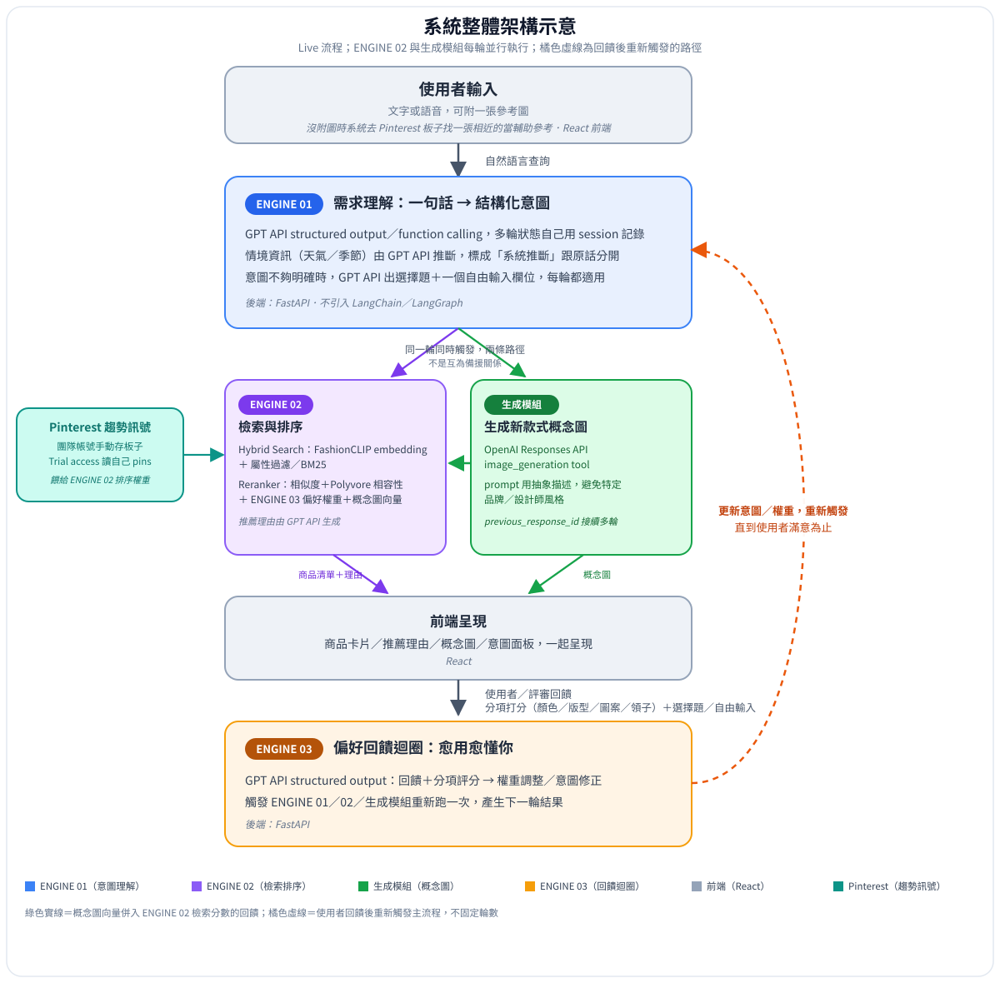
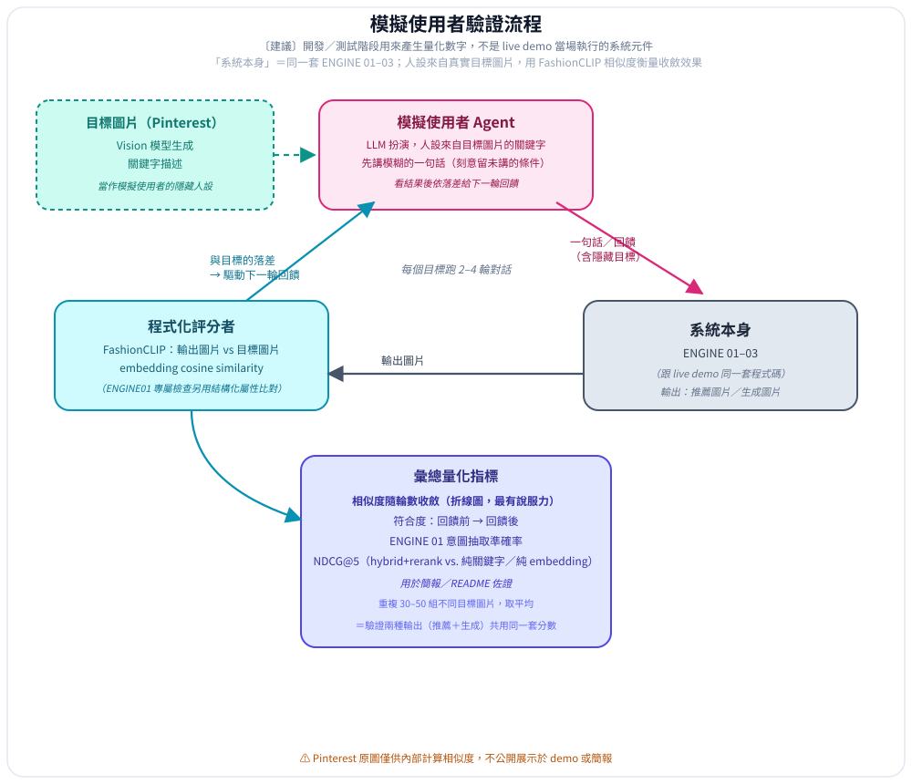

# PRD — Consumer Intent Agent

Skeleton following the brief's own "PRD 撰寫指南" (hackathon-brief.md), which says to copy from that document's sections rather than rewrite from scratch. Sections marked **TBD** need the team's input before this is final.

## 1. Product goal & scope

MCHackathon 2026 x Makalot Industrial (聚陽實業), theme "一句話讀懂消費者." Makalot manufactures for brand clients and already collects post-purchase feedback (VOC) but has no signal on pre-purchase consumer intent — the gap this project fills. Goal: turn a shopper's one sentence into structured, explainable intent that can flow back through the design pipeline (trend → designer → material/production → brand store). See [hackathon-brief.md](hackathon-brief.md) "基本資訊" / "交付項目" / "企業背景與痛點" / "題目核心要求".

## 2. System architecture

Two loops share the same ENGINE01–03 code — live (real user/judge) and offline validation (simulated user, dev-time only). Full description: [hackathon-brief.md](hackathon-brief.md) "整體怎麼運作：兩條迴圈，共用一套引擎", condensed in root `CLAUDE.md`.

## 3. Module specs

- [ENGINE01 — Intent Understanding](engine01-intent.md)
- [ENGINE02 — Retrieval & Ranking](engine02-retrieval.md)
- [ENGINE03 — Preference Feedback Loop](engine03-feedback.md)
- [Frontend](frontend.md)
- [Pinterest & Generation](pinterest-and-generation.md)

## 4. Interface contract

[interface-contract.md](interface-contract.md) — **draft v1, needs sign-off from all engine owners.** This is the actual precondition for the 5 lines being able to build in parallel; don't start ENGINE02/03/frontend against it without confirming the fields first.

## 5. Validation & quantified metrics

[validation-plan.md](validation-plan.md) — offline (ENGINE01 accuracy, ENGINE02 ablation), live on-stage match score, and the dev-time simulated-user convergence study.

## 6. Timeline & ownership — TBD

5 people, 6 lines (ENGINE01/02/03, frontend, Pinterest+generation combined). Per the brief's suggested split: one person each on ENGINE01/02/03/frontend, Pinterest+generation combined for the fifth. Confirmed so far:

| Line | Owner |
|---|---|
| ENGINE01 | this repo's scaffold owner |
| Pinterest board curation | 品諭 |
| ENGINE02 | TBD |
| ENGINE03 | TBD |
| Frontend | TBD |
| Generation module | TBD |

Coding happens on-site over the two competition days (2026-09-19 +); pre-event time goes to locking architecture, ownership, and the interface contract above — not writing feature code.

## 7. Open items to close before this PRD is final

Copied from [hackathon-brief.md](hackathon-brief.md) "寫 PRD 前還要定案的事項", plus what was actually found while scaffolding this repo:

- **Resolved for ENGINE01:** the team wants to avoid spending money, so ENGINE01 was switched to `codex exec` (rides ChatGPT Plus/Pro, $0/call, but ~8–17s and ~14-20K shared-quota tokens per call, measured — see root `CLAUDE.md` "ENGINE01 runtime: codex exec"). **Still open for ENGINE02/03/generation:** nobody on the team has a platform.openai.com API key; each of those owners needs to decide whether to get one or find their own zero-cost path.
- Product catalog dataset: **confirmed**, Polyvore Outfits Dataset.
- Which specific target images go on the curated Pinterest board (品諭).
- Demo script: what exactly gets asked/fed back in round 1 vs. round 2.
- Validation-loop image generation: the brief's original plan (Hermes Agent + Codex-auth for batch image gen) hasn't been tested in this repo yet — whoever owns the generation/validation line should verify it the same way ENGINE01's `codex exec` path was verified (actually run it, measure latency/quota) rather than assume the brief's description still holds.
